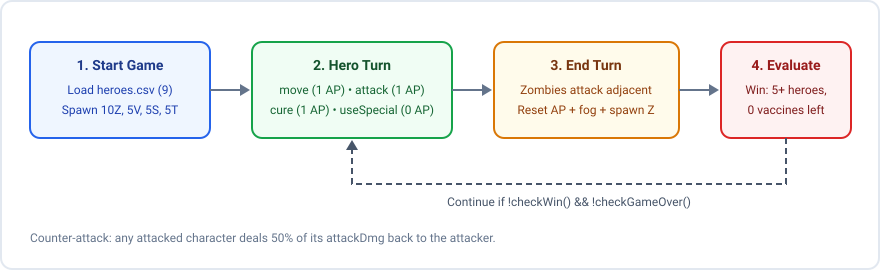
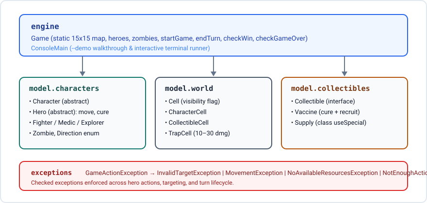

# cs4-game (The Last of Us: Legacy)

A turn-based zombie survival game engine in Java 17 with a 15 × 15 fog-of-war grid, three hero classes, a terminal runner, and 299 JUnit 4 tests.

[](https://github.com/andrew-abdelmalak/cs4-game/actions/workflows/build.yml)
[](https://github.com/andrew-abdelmalak/cs4-game/actions/workflows/codeql.yml)
[](LICENSE)

We built the core engine as a two-person team (**Andrew Abdelmalak** and **Youssef Ramy Farid**) for the German University in Cairo course **CSEN 401: Computer Programming Lab** (Spring 2023), then added a Maven build, a terminal demo runner, and gameplay tests for portfolio sharing.

## Quick start

Prerequisites: Java 17 (JDK 17 or later) and Apache Maven 3.9+.

Run the full 299-test JUnit 4 suite:

```bash
git clone https://github.com/andrew-abdelmalak/cs4-game.git
cd cs4-game
mvn clean test
```

Run the automated 6-turn ASCII board walkthrough:

```bash
mvn -q exec:java -Dexec.args="--demo"
```

Run an interactive terminal session:

```bash
mvn -q exec:java
```

Compile main sources directly without Maven (`0` warnings):

```bash
javac -Xlint:all -Werror -d bin \
  src/exceptions/*.java \
  src/model/collectibles/*.java \
  src/model/world/*.java \
  src/model/characters/*.java \
  src/engine/*.java
```

<details>
<summary>Sample output from the automated <code>--demo</code> walkthrough</summary>

```text
=== The Last of Us: Legacy: Automated Engine Demo ===
Loaded 9 heroes from heroes.csv. Starting hero: Joel Miller (Fighter, HP 140/140, Actions 5, ATK 30)
Initial map: 10 zombies, 5 vaccines, 5 supplies, 5 hidden traps.
...
--- Turn 3 ---
  Joel Miller cured Zombie 2 (heroes=1->2).
...
=== Final Demo Board (Fog-of-War View) ===
     0 1 2 3 4 5 6 7 8 9 0 1 2 3 4
14 | # # # # # # # # # # # # # # #
13 | # # # # # # # # # # # # . . .
12 | . . # # # # # # # # # # . H .
11 | H . # # # # # # # # # # Z . .
...
Legend: H=Hero  Z=Zombie  V=Vaccine  S=Supply  .=Empty  #=Fog
```

</details>

## Game mechanics

| Property | Value |
|---|---|
| Grid size | `15 × 15` (`Game.MAP_SIZE`) |
| Initial entities | 1 hero at `(0, 0)`, 10 zombies, 5 vaccines, 5 supplies, 5 hidden traps |
| Trap damage | `10`, `20`, or `30` HP on entry (`TrapCell`) |
| Zombie stats | `40` HP, `10` attack damage (`5` HP counter-attack) |
| Win condition | At least 5 living heroes and 0 vaccines left on the map or in inventories |
| Lose condition | All heroes die, or 0 vaccines remain before reaching 5 heroes |

### Hero classes and actions

Every hero starts each turn with `maxActions` action points (`AP`) and can perform four actions:

- **Move (`1 AP`):** Step one cell in one of four cardinal directions (`UP`, `DOWN`, `LEFT`, `RIGHT`; no diagonal movement). Entering a cell picks up any `Vaccine` or `Supply`, triggers any `TrapCell`, and reveals the destination cell plus its 8 neighbors.
- **Attack (`1 AP`):** Strike an adjacent zombie (within Chebyshev distance 1). Any attacked character counter-attacks via `defend()`, dealing `attackDmg / 2` back to the attacker. Defeated zombies respawn at a random empty cell.
- **Use special (`0 AP`):** Consumes one `Supply` from `supplyInventory` to activate the hero's class ability:
  - `Fighter`: attacks cost `0 AP` for the rest of the turn.
  - `Explorer`: reveals all 225 cells on the map until `endTurn()` (usable once per turn).
  - `Medic`: restores the targeted self or adjacent hero to `maxHp`.
- **Cure (`1 AP`):** Any hero class (`Fighter`, `Medic`, or `Explorer`) holding a `Vaccine` can cure an adjacent targeted zombie, replacing it with a random hero recruited from `Game.availableHeroes`.

### Turn lifecycle and fog of war

At the start of a game, only `(0, 0)` and its three adjacent cells `(0, 1)`, `(1, 0)`, and `(1, 1)` are visible. Moving reveals cells encountered during the turn. When `Game.endTurn()` runs:

1. Each zombie attempts one attack on a random adjacent hero.
2. Every cell on the `15 × 15` grid resets to hidden (`isVisible = false`), leaving visible only each living hero's cell and its 8 adjacent cells.
3. Each hero's action points reset to `maxActions`, `specialAction` resets to `false`, and targets clear.
4. One new zombie spawns on an empty cell not adjacent to another zombie.

<picture>
  <source media="(prefers-color-scheme: dark)" srcset="docs/diagrams/turn-loop-dark.svg">
  <source media="(prefers-color-scheme: light)" srcset="docs/diagrams/turn-loop.svg">
  
</picture>

## Architecture

The codebase separates engine coordination, character hierarchy, board cells, collectibles, and checked domain exceptions into distinct packages:

<picture>
  <source media="(prefers-color-scheme: dark)" srcset="docs/diagrams/architecture-dark.svg">
  <source media="(prefers-color-scheme: light)" srcset="docs/diagrams/architecture.svg">
  
</picture>

```text
.
├── .github/                  # CI, CodeQL, Dependabot, community files, templates
├── assets/                   # Social preview SVG and 1280x640 PNG
├── docs/diagrams/            # Light and dark architecture and turn-loop SVGs
├── heroes.csv                # 9 playable hero definitions
├── pom.xml                   # Maven build (Java 17, JUnit 4.13.2, exec plugin)
└── src/
    ├── engine/               # Game state/loop and ConsoleMain CLI runner
    ├── exceptions/           # GameActionException and 4 checked subclasses
    ├── model/
    │   ├── characters/       # Character, Hero, Fighter, Medic, Explorer, Zombie, Direction
    │   ├── collectibles/     # Collectible interface, Vaccine, Supply
    │   └── world/            # Cell, CharacterCell, CollectibleCell, TrapCell
    └── tests/                # M1PublicTests (169), M2PublicTests (120), EngineGameplayTest (10)
```

### Design constraints and limitations

- **Static game state and reflection tests:** `Game` exposes `public static` collections (`availableHeroes`, `heroes`, `zombies`, `map`) because the course grading suites (`M1PublicTests` and `M2PublicTests`) read and mutate those exact fields via Java reflection.
- **Coordinate fallback in combat, heal, and cure:** `Character.attack()`, `Hero.cure()`, and `Medic.useSpecial()` keep a `Game.isAdjacent()` coordinate fallback in addition to scanning `Game.map` because several unit tests set character locations directly without inserting characters into `Game.map`.
- **Console runner only:** This repository covers Milestones 1 and 2 (the engine and test suites) plus `ConsoleMain`; a desktop GUI (JavaFX/Swing) is outside the scope of this repository.

## Hero roster (`heroes.csv`)

Schema: `Name,Type,MaxHP,MaxActions,AttackDmg` (valid `Type` codes: `FIGH`, `MED`, `EXP`).

| Hero | Class | Max HP | Max Actions | Attack Damage |
|---|---|---:|---:|---:|
| Joel Miller | `Fighter` (`FIGH`) | 140 | 5 | 30 |
| Ellie Williams | `Medic` (`MED`) | 110 | 6 | 15 |
| Tess | `Explorer` (`EXP`) | 80 | 6 | 20 |
| Riley Abel | `Explorer` (`EXP`) | 90 | 5 | 25 |
| Tommy Miller | `Explorer` (`EXP`) | 95 | 5 | 25 |
| Bill | `Medic` (`MED`) | 100 | 7 | 10 |
| David | `Fighter` (`FIGH`) | 150 | 4 | 35 |
| Henry Burell | `Medic` (`MED`) | 105 | 6 | 15 |
| Andrew Beda | `Explorer` (`EXP`) | 3 | 1 | 99 |

## Authors and acknowledgments

- **Andrew Abdelmalak** ([@andrew-abdelmalak](https://github.com/andrew-abdelmalak)): Mechatronics Engineering, German University in Cairo
- **Youssef Ramy Farid** ([@youssefrfarid](https://github.com/youssefrfarid)): Computer Science, German University in Cairo

The course instructors for **CSEN 401: Computer Programming Lab** at the German University in Cairo provided the public milestone suites (`M1PublicTests` and `M2PublicTests`).

## Contributing, security, and license

- Contributions: see [.github/CONTRIBUTING.md](.github/CONTRIBUTING.md) and [.github/CODE_OF_CONDUCT.md](.github/CODE_OF_CONDUCT.md).
- Security reports: see [.github/SECURITY.md](.github/SECURITY.md).
- Release history: see [CHANGELOG.md](CHANGELOG.md).
- License: distributed under the [MIT License](LICENSE).
